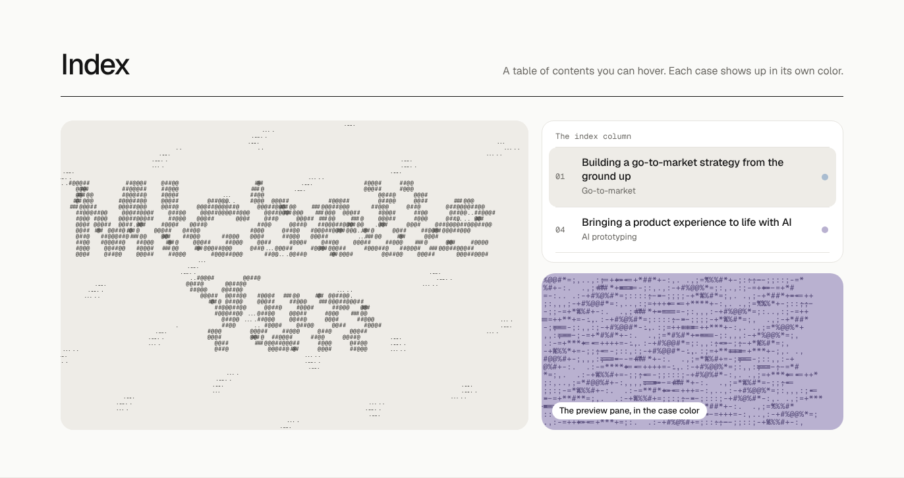

[](https://michelleyun.github.io/portfolio-2/)

# Michelle Yun

**Solutions Engineer** · Chicago, Illinois

I turn technical complexity into clear plans and measurable outcomes.

[Portfolio](https://michelleyun.github.io/portfolio-2/) · [LinkedIn](https://www.linkedin.com/in/michelleyun5) · [Email](mailto:michelleyoungyun@gmail.com)

Seven years of experience across audience research, data analytics, and solutions engineering. I started my career in consumer intelligence, helping brands and agencies understand their audiences and make more informed marketing decisions. I then moved into solutions engineering, where I work closely with customers, product teams, engineers, and commercial stakeholders.

## Case studies

| | Case study | Focus |
|---|---|---|
| 01 | [Building a go-to-market strategy from the ground up](case-studies/01-go-to-market.md) | Go-to-market |
| 02 | [Defining what to build for a strategic partner](case-studies/02-product-strategy.md) | Product strategy |
| 03 | [Building a better way to manage technical integrations](case-studies/03-program-management.md) | Program management |
| 04 | [Bringing a product experience to life with AI](case-studies/04-ai-prototyping.md) | AI prototyping |
| 05 | [Turning consumer insights into actionable marketing strategies](case-studies/05-consumer-insights.md) | Consumer insights |
| 06 | [Winning a head-to-head evaluation against an incumbent](case-studies/06-competitive-strategy.md) | Competitive strategy |

## Experience

- **Integral Ad Science** · Solutions Engineer · 2025–present
- **Nexxen** (formerly Amobee) · Solutions Engineer, Enterprise · 2021–2025
- **Nexxen** (formerly Amobee) · Analyst, Advanced Insights & Data · 2019–2021

**Independent:** Succession, go-to-market consultant · Michelle Yun Photography

**Education:** Northwestern University, B.A. Communication Studies, concentration in Integrated Marketing Communications

## Photography

Portraits of some very good dogs, shot around Chicago. [See them on the site →](https://michelleyun.github.io/portfolio-2/#photography)

## Design system

The colors, type and components behind the site. [See the design system →](design-system/)

[](design-system/)

## About this repository

This repository powers my [portfolio site](https://michelleyun.github.io/portfolio-2/), published with GitHub Pages.

```
index.html        the live site: the case study index
case-01.html …    one page per case study, 01 to 06
about.html        about, background, toolkit and contact
photography.html  dog portraits
og.png            link preview image
case-studies/     each case study, readable here on GitHub
assets/           portraits, dog photography, KJ animations, css and js
design-system/    colors, type, spacing and components
build/            the script that writes the pages from one file of copy
```
