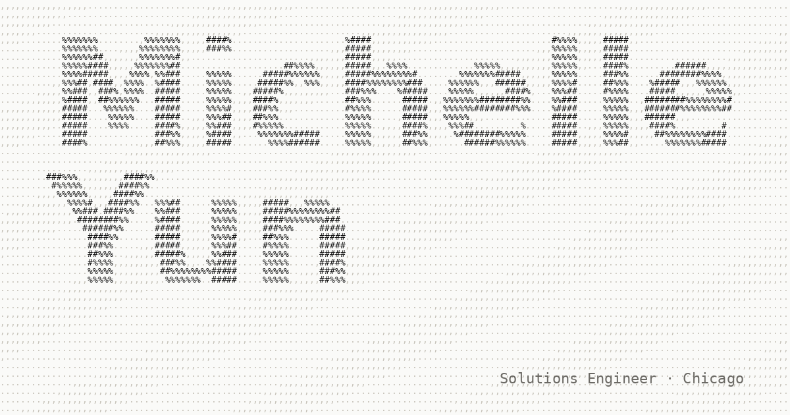

[](https://michelleyun.github.io/portfolio-2/)

# Michelle Yun

**Solutions Engineer** · Chicago, Illinois

I turn technical complexity into clear plans and measurable outcomes.

[Portfolio](https://michelleyun.github.io/portfolio-2/) · [LinkedIn](https://www.linkedin.com/in/michelleyun5) · [Email](mailto:michelleyoungyun@gmail.com)

## Case studies

| | Case study | Focus |
|---|---|---|
| 01 | [Building a go-to-market strategy from the ground up](https://michelleyun.github.io/portfolio-2/#case-01) | Go-to-market |
| 02 | [Defining what to build for a strategic partner](https://michelleyun.github.io/portfolio-2/#case-02) | Product strategy |
| 03 | [Building a better way to manage technical integrations](https://michelleyun.github.io/portfolio-2/#case-03) | Program management |
| 04 | [Bringing a product experience to life with AI](https://michelleyun.github.io/portfolio-2/#case-04) | AI prototyping |
| 05 | [Turning consumer insights into actionable marketing strategies](https://michelleyun.github.io/portfolio-2/#case-05) | Consumer insights |
| 06 | [Winning a head-to-head evaluation against an incumbent](https://michelleyun.github.io/portfolio-2/#case-06) | Competitive strategy |

Also: [Photography](https://michelleyun.github.io/portfolio-2/photography.html), portraits of some very good dogs.

## How the site is built

Plain HTML, CSS and JavaScript, with no framework and no build step needed to host it.

```
index.html            Home: the case study index with a live preview
photography.html      Dog portraits, drawn in characters until you hover
about.html            About, background, toolkit and contact
case-01.html … case-06.html   One page per case study
css/site.css          All styles, including the case study colours
js/site.js            Character art, clock, menu, tabs and the case 04 prototype
assets/               Portrait, photos, KJ animations, favicon
og.png                Link preview image
build/                The script that writes the pages from one file of copy
```

To change wording, edit `build/content.py` (or `build/visuals.py` for the case study visuals), then run `python3 build/build.py .` from the repo root. It needs Python 3 with Pillow.
