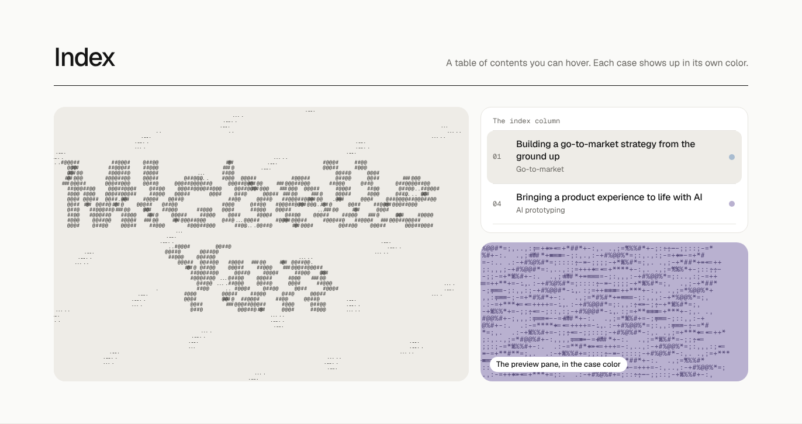
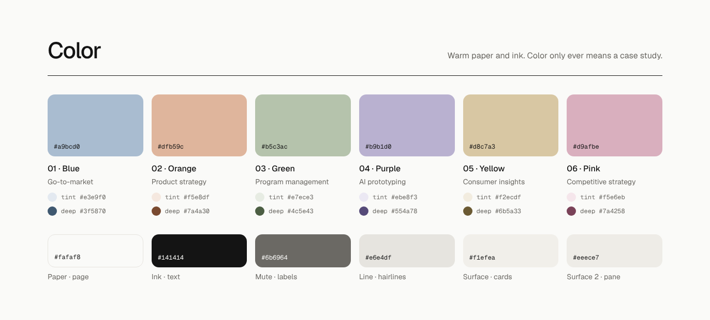
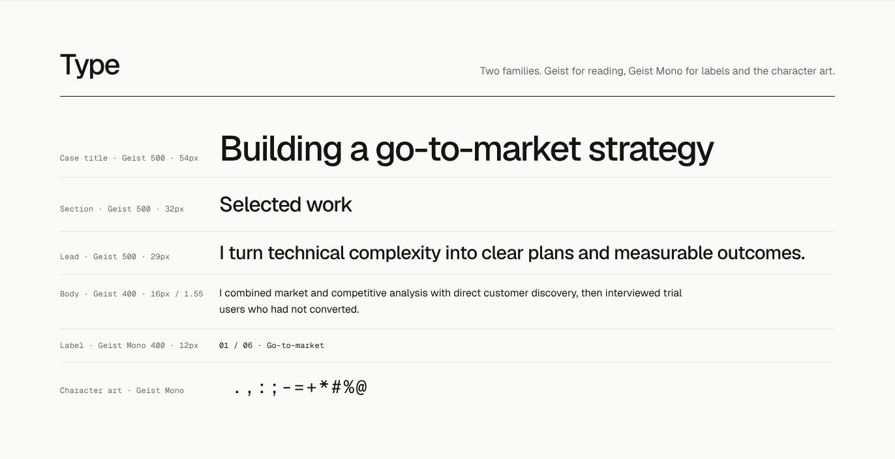
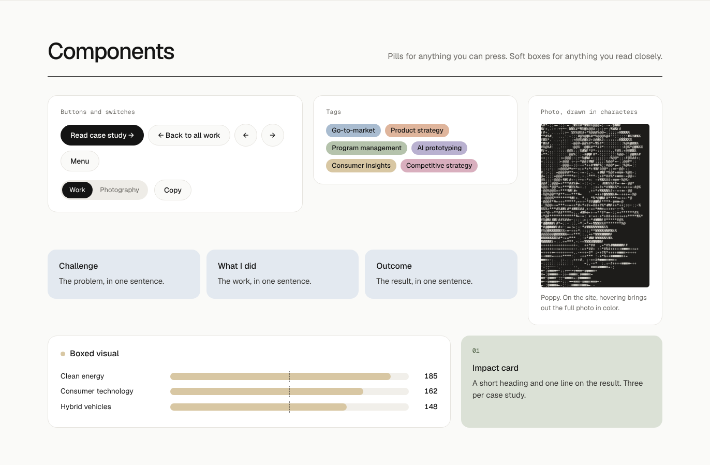
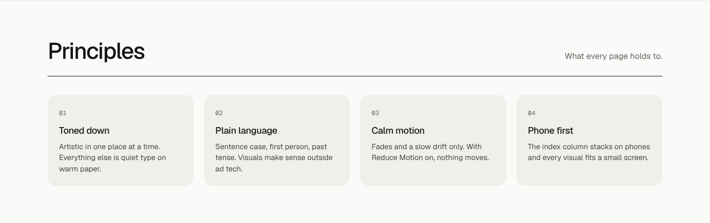

# Design system · Index

The colors, type, components and principles behind [michelleyun.github.io/portfolio-2](https://michelleyun.github.io/portfolio-2/).

**The idea:** an index. A calm list of work sits on the left, and the work you point at shows up on the right, drawn in characters in its own color. The name, the photos and one pattern at a time are the art. Everything else is quiet type on warm paper.

[tokens.css](tokens.css) has every color, font and spacing value in one file.

## Color

Warm paper and ink. Color only ever means a case study, and text on a case color is always ink.

| Token | Value | Used for |
|---|---|---|
| `--bg` | `#fafaf8` | Page |
| `--ink` | `#141414` | Text, active pills |
| `--mute` | `#6b6964` | Secondary text, labels |
| `--line` | `#e6e4df` | Hairlines, pill borders |
| `--surf` | `#f1efea` | Cards, toolkit groups |
| `--surf-2` | `#eeece7` | Preview pane, hovered rows, switches |
| `--paper` | `#ffffff` | Boxed visuals |

Each case has a mid-tone, a light tint and a deep shade.

| Case | Mid-tone | Tint | Deep | Focus |
|---|---|---|---|---|
| 01 | Blue `#a9bcd0` | `#e3e9f0` | `#3f5870` | Go-to-market |
| 02 | Orange `#dfb59c` | `#f5e8df` | `#7a4a30` | Product strategy |
| 03 | Green `#b5c3ac` | `#e7ece3` | `#4c5e43` | Program management |
| 04 | Purple `#b9b1d0` | `#ebe8f3` | `#554a78` | AI prototyping |
| 05 | Yellow `#d8c7a3` | `#f2ecdf` | `#6b5a33` | Consumer insights |
| 06 | Pink `#d9afbe` | `#f5e6eb` | `#7a4258` | Competitive strategy |

The mid-tone fills the tag, the preview pane, the band at the top of the case study and the bars in its charts. The tint fills the summary cards. The deep shade draws the character art and small accents.

## Type

| Role | Face | Size |
|---|---|---|
| Case title | Geist 500 | up to 54px |
| Section heading | Geist 500 | 32px |
| Lead text | Geist 500 | 29px |
| Body | Geist 400 | 16px / 1.55 |
| Labels, numbers | Geist Mono 400 | 12px |
| Character art | Geist Mono 400 | 6–12px, drawn on canvas |

Sentence case everywhere. Large sizes use tight negative tracking. Body text uses none.

## Components

- **Pill buttons:** every button, switch and tag is fully rounded and set in Geist.
- **Work / Photography switch:** the one control at the top of the index column.
- **Index rows:** number, title and tag. Hover or focus fills the row and shows that case in the preview pane.
- **Tags:** the case mid-tone with ink text.
- **Photos in characters:** each photo is drawn in characters on a dark ground and fades to the full photo in color on hover, or on tap on phones. Photos are never cropped.
- **Summary cards:** Challenge · What I did · Outcome, in the case tint.
- **Boxed visual:** a white box with a hairline border and a small case-colored dot beside the title.
- **Impact cards:** three per case study, in a soft mix of the case color.

## Principles

## Layout and motion

- Desktop: an index column of `clamp(340px, 28vw, 430px)` on the left and the main pane on the right. Phones: one column with a sticky bar and a Menu pill.
- 60px between the parts of a case study.
- Motion is limited to fades and a slow drift in the patterns. With Reduce Motion on, the intro is skipped, the patterns hold still and KJ stays in place.
